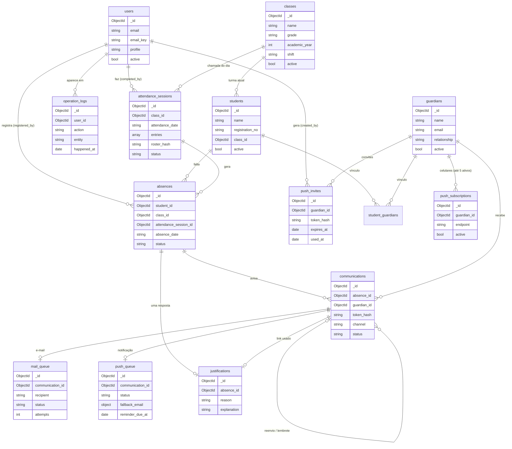
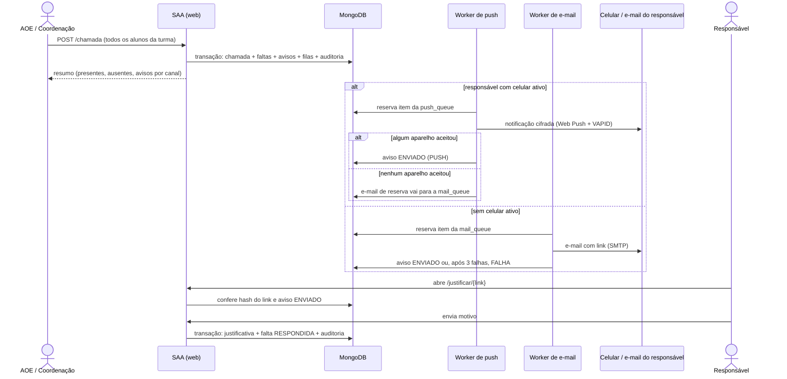
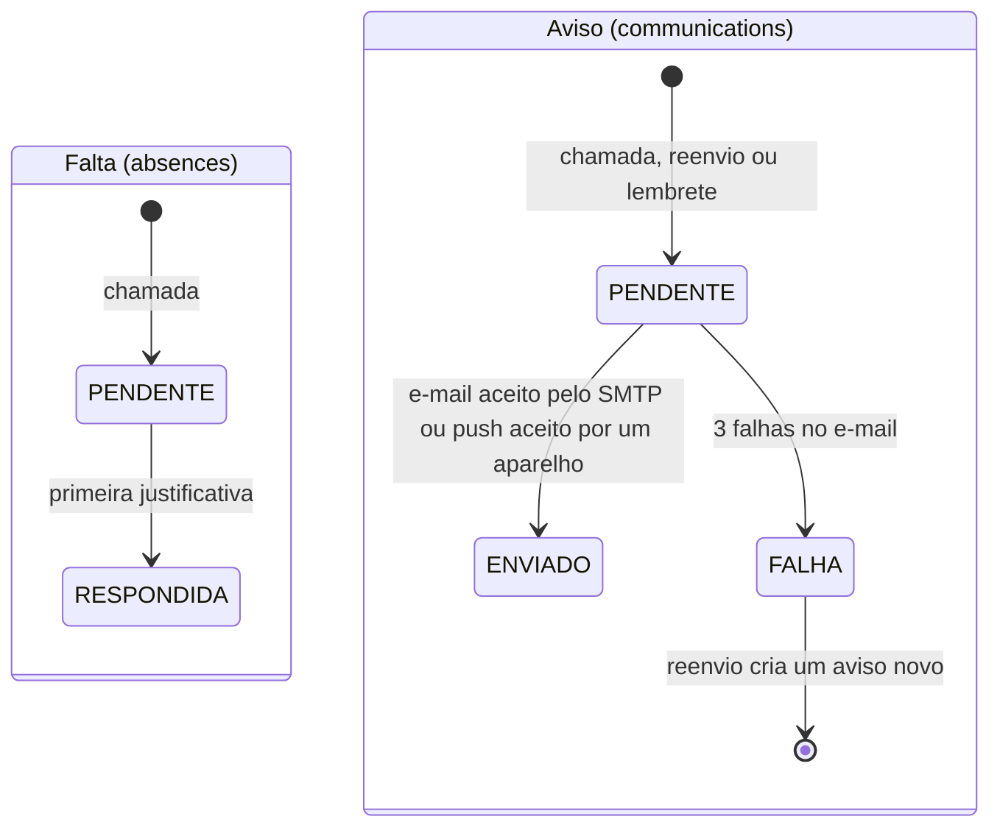
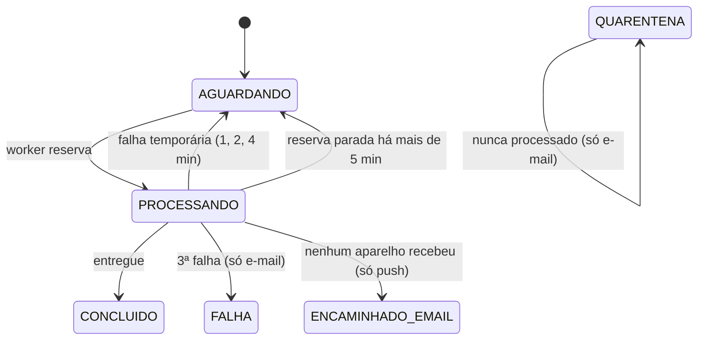

# Diagramas — Sistema de Ausência de Alunos (SAA)

**Repositório:** [Grupo-EVITUS/PI3-2026](https://github.com/Grupo-EVITUS/PI3-2026)
**Atualizado em:** 18/11/2026 (branch `refactor/remover-sqlite`)

Esta pasta tem dois conjuntos:

1. **[Diagramas atuais](#diagramas-atuais-php--mongodb)**, em Mermaid, escritos neste arquivo. O GitHub os desenha direto na página, e o texto é a fonte editável. Representam o sistema em PHP + MongoDB.
2. **[Diagramas históricos](#diagramas-históricos-php--sqlite)**, os seis PNG das subpastas. Representam a primeira versão, em PHP + SQLite (commit `a0e7781`, 28/10/2026), que foi substituída.

## Diagramas atuais (PHP + MongoDB)

### Coleções e relacionamentos

O MongoDB não tem chaves estrangeiras: as setas são referências por `ObjectId`, mantidas pelas classes `Mongo*` dentro de transações. Detalhes de cada coleção na [referência do banco](../MONGODB_FOUNDATION.md).

### Da chamada à justificativa

### Estados

A falta e o aviso:

As filas (`mail_queue` e `push_queue`):

### Premissas representadas

1. Uma falta é **aluno + dia**, nunca por aula. A turma da falta é a do dia da chamada.
2. A chamada inclui **todos** os alunos ativos da turma; cada turma tem uma chamada por dia.
3. `PENDENTE`/`RESPONDIDA` é o estado da **falta** (com ou sem justificativa); `PENDENTE`/`ENVIADO`/`FALHA` é o estado do **aviso**; os estados das **filas** são os do último diagrama.
4. O responsável não tem login: o link (guardado como hash) é a credencial, e a primeira justificativa encerra a falta.
5. "Enviado" significa aceito pelo servidor SMTP ou pelo serviço de push; não comprova leitura. Por isso existe o lembrete por e-mail depois de um push sem resposta.
6. Perfis: **AOE** faz a chamada e acompanha; **Coordenação** também cadastra; **Diretor** só consulta.

## Diagramas históricos (PHP + SQLite)

Os seis PNG abaixo foram feitos para a primeira versão do sistema, em PHP + SQLite (commit `a0e7781`, 28/10/2026). Ficam como registro do projeto. **Não descrevem o sistema atual**, principalmente nos seguintes pontos:

- o **DER** mostra tabelas SQLite; hoje são as coleções do diagrama acima;
- o diagrama de **classes** mostra entidades do domínio, e o texto original citava as classes PHP `Auth`, `Database` e `Services`, das quais `Database` e `Services` não existem mais;
- o registro era por **aluno ausente**; hoje é a **chamada completa** da turma;
- o aviso era só por **e-mail**; hoje há notificação push com e-mail de reserva;
- os estados não incluem reserva vencida, `QUARENTENA`, `ENCAMINHADO_EMAIL` nem lembrete.

| Diagrama | Imagem |
|---|---|
| Casos de uso | [PNG](Diagrama%20de%20Caso%20de%20Uso/01_casos_de_uso.png) |
| Atividades / fluxo | [PNG](Diagrama%20de%20Fluxo/02_atividades_fluxo.png) |
| Classes do domínio | [PNG](Diagram%20De%20Classe/03_classes_dominio.png) |
| DER do SQLite | [PNG](Diagrama%20Entidade-Relacionamento/04_der_sqlite.png) |
| Sequência | [PNG](Diagrama%20de%20Sequ%C3%AAncia/05_sequencia_registro_justificativa.png) |
| Estados | [PNG](Diagrama%20de%20Estados/06_estados_ausencia_comunicacao%20%282%29.png) |

Os PNG não têm fonte editável no repositório. Para um diagrama novo, prefira Mermaid neste arquivo: o texto fica versionado e o GitHub desenha a imagem.
