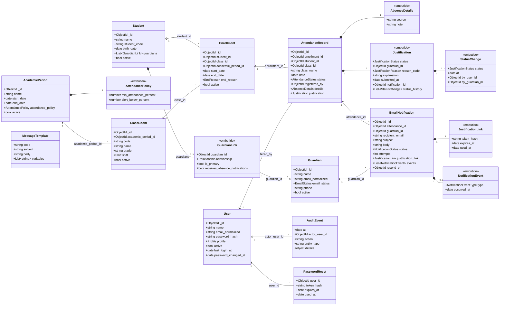

# Diagrama de classes — SAA

**Issue:** #18 — Desenvolvimento do diagrama de classes (milestone *Sprint 4 – Arquitetura e Protótipos*)
**Fontes:** [`docs/MODELAGEM_MONGODB.md`](MODELAGEM_MONGODB.md) (dados) e as classes reais de [`src/`](../src/) (aplicação).
Os diagramas também estão em [`diagramas/diagrama_classes.mmd`](diagramas/diagrama_classes.mmd) (domínio) e
[`diagramas/diagrama_arquitetura.mmd`](diagramas/diagrama_arquitetura.mmd) (arquitetura) e são renderizados pelo GitHub (Mermaid).

O SAA é descrito em dois níveis:

1. **Domínio** — as entidades do negócio e como se relacionam. Cada classe corresponde a uma coleção do MongoDB ou a um
   subdocumento **embutido** (composição ◆). Referências entre coleções aparecem como associação (→).
2. **Arquitetura** — as classes PHP que implementam o sistema, organizadas em camadas MVC + serviços.

## 1. Domínio

Leitura do diagrama:

- **Aluno ↔ responsável:** o vínculo (parentesco, principal, recebe avisos) é embutido no aluno (no máximo 3); o
  contato do responsável é uma entidade própria porque um responsável pode ter vários filhos.
- **Histórico:** `Enrollment` registra cada passagem do aluno por uma turma; `AttendanceRecord` guarda a turma do dia
  (`class_id` + `class_name`), então mudar de turma não altera faltas antigas.
- **Ocorrência:** a falta (`AttendanceRecord` com status `ABSENT`) carrega a `Justification` com o histórico de status
  (`PENDING → RESPONDED`). Cada responsável recebe um `EmailNotification` com seu próprio link (só o hash do token).
- `LoginAttempt` (limite de tentativas) não aparece por não ter relacionamentos.

### Enumerações (`src/Domain`)

```mermaid
classDiagram
    direction LR
    class Profile {
        <<enumeration>>
        ADMIN
        COORDINATION
        AOE
        SECRETARY
        GUARDIAN
    }
    class AttendanceStatus {
        <<enumeration>>
        PRESENT
        ABSENT
        EXCUSED
    }
    class JustificationStatus {
        <<enumeration>>
        PENDING
        RESPONDED
    }
    class JustificationReason {
        <<enumeration>>
        ILLNESS
        MEDICAL
        FAMILY
        TRANSPORT
        OTHER
    }
    class NotificationStatus {
        <<enumeration>>
        PENDING
        SENT
        DELIVERED
        OPENED
        FAILED
    }
    class NotificationEventType {
        <<enumeration>>
        SENT
        DELIVERED
        OPENED
        FAILED
        LINK_ACCESSED
    }
    class Shift {
        <<enumeration>>
        MORNING
        AFTERNOON
        NIGHT
        FULL_TIME
    }
    class EmailStatus {
        <<enumeration>>
        VALID
        UNVERIFIED
        BOUNCED
    }
    class Relationship {
        <<enumeration>>
        PAI
        MAE
        RESPONSAVEL
    }
    class EndReason {
        <<enumeration>>
        CLASS_CHANGE
        TRANSFER
        PERIOD_END
    }
```

Cada enum tem `label()` com o texto em português (ex.: `Profile::SECRETARY->label()` = "Secretária") e `values()`,
usado pelos validators do MongoDB — assim o código e o banco aceitam exatamente os mesmos valores.

## 2. Arquitetura (classes PHP)

```mermaid
classDiagram
    direction TB

    class App {
        +boot() App
        +run() void
        +handle(Request) Response
    }
    class Router {
        +get(path, handler, options)
        +post(path, handler, options)
        +group(options, callback)
        +resolve(method, path) array
        +has(path) bool
    }
    class Route {
        +string method
        +string path
        +string access
        +string permission
        +bool csrf
    }
    class Request {
        +string(key) string
        +int(key) int
        +param(name) string
        +user() array
    }
    class Response {
        +html(body, status) Response
        +json(data, status) Response
        +redirect(to) Response
    }
    class View {
        +render(template, data, layout) string
        +partial(name, data) string
    }
    class Session {
        +start()
        +regenerate()
        +invalidate()
        +flash(kind, message)
        +expiredReason() string
    }
    class Csrf {
        +token() string
        +verify(Request)
    }
    class Container {
        +get(id)
        +singleton(id, factory)
    }
    class Validator {
        +make(data) Validator
        +required(field)
        +email(field)
        +passes() bool
        +errors() array
    }
    class SecurityHeaders {
        +apply(Response, Request) Response
    }
    class Permissions {
        +can(profile, permission) bool
        +grants() array
    }

    class Controller {
        <<abstract>>
        #render(template, data) Response
        #redirect(path) Response
    }
    class AuthController {
        +showLogin(Request) Response
        +login(Request) Response
        +logout(Request) Response
        +forgotPassword(Request) Response
    }
    class HomeController {
        +root(Request) Response
        +index(Request) Response
    }
    class ProfileController {
        +me(Request) Response
        +matrix(Request) Response
    }
    class HealthController {
        +show(Request) Response
    }

    class AuthService {
        +attempt(email, password, ip) array
        +logout()
        +currentUser() array
        +createUser(data) string
    }
    class AuditService {
        +record(action, entityType, entityId, details)
    }
    class SystemStatusService {
        +health() array
        +environment() array
    }

    class Model {
        <<abstract>>
        #Collection collection
    }
    class UserModel {
        +create(data) ObjectId
        +findByEmail(email) array
        +findActiveById(id) array
        +touchLogin(id)
    }
    class LoginAttemptModel {
        +record(key)
        +countSince(key, since) int
    }
    class AuditEventModel {
        +insert(event)
        +latest(limit) array
    }
    class SystemModel {
        +ping() bool
        +serverVersion() string
    }

    class Mongo {
        +database() Database
        +collection(name) Collection
        +ping() bool
    }
    class Schema {
        +initialize(Database)
        +definitions() array
    }

    App --> Router
    App --> Container
    App --> Session
    App --> SecurityHeaders
    App ..> Permissions : controle de acesso por rota
    Router "1" *-- "*" Route
    App ..> Request
    App ..> Response
    Controller <|-- AuthController
    Controller <|-- HomeController
    Controller <|-- ProfileController
    Controller <|-- HealthController
    Controller ..> View
    AuthController --> AuthService
    HomeController --> SystemStatusService
    HealthController --> SystemStatusService
    AuthService --> UserModel
    AuthService --> LoginAttemptModel
    AuthService --> AuditService
    AuthService --> Session
    AuthService --> Csrf
    AuditService --> AuditEventModel
    SystemStatusService --> SystemModel
    Model <|-- UserModel
    Model <|-- LoginAttemptModel
    Model <|-- AuditEventModel
    Model <|-- SystemModel
    Model ..> Mongo : Database injetado
    Schema ..> Mongo
```

Regras de dependência (ver [ARQUITETURA.md](ARQUITETURA.md), seção 3): **Controllers** tratam HTTP e chamam
**Services**; Services aplicam as regras de negócio usando **Models**; somente os Models falam com o MongoDB. O
`App` (kernel) aplica sessão, CSRF e permissão de cada rota antes de chamar o controller. Classes de apoio não
desenhadas: `Clock`, `Config`, `Navigation`, `Bson`, `Collections`, exceções HTTP (`src/Core/Exceptions`) e
utilitários de `src/Support` (`Dates`, `Labels`, `SafeRedirect`, `StaticFiles`, `PasswordHasher`, `Email`).

Nas próximas etapas entram, na mesma estrutura, os cadastros (alunos, responsáveis, turmas, usuários), o registro de
ausências, as notificações por e-mail, a justificativa, as ocorrências e o dashboard; este diagrama será atualizado a
cada etapa.
