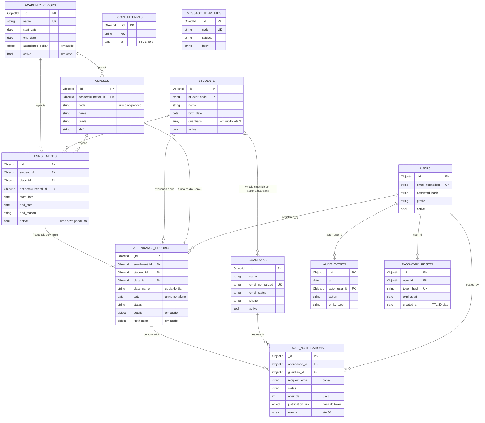

# Modelagem de dados do SAA — MongoDB

**Projeto:** SAA — Sistema de Ausência de Alunos (PI3 2026, Grupo EVITUS)
**Issue:** #20 — Planejar os requisitos da modelagem de dados (milestone *Sprint 4 – Arquitetura e Protótipos*)
**Implementação:** [`src/Database/Schema.php`](../src/Database/Schema.php) · criação do banco: `php bin/init_db.php`
**Base:** atividade de modelagem do grupo (8 coleções), adaptada à aplicação em PHP

> **Este documento é testado.** Cada exemplo JSON da seção 4 é inserido no MongoDB pelos testes e precisa ser aceito
> pelo validator real (`SchemaTest::testEveryJsonExampleInTheDocumentationIsAcceptedByItsValidator`), e cada
> requisito da seção 2 aponta para testes que existem e carregam o mesmo grupo
> (`SchemaTest::testDocumentationRequirementsPointToExistingTestsThatCarryTheSameGroup`). Para conferir um requisito:
> `php vendor/bin/phpunit --group MD-03`.

## 1. Objetivo

Guardar alunos, responsáveis, turmas, períodos letivos, matrículas, frequência diária, justificativas, e-mails enviados e
usuários internos de forma que:

1. as três operações mais usadas no dia a dia (localizar o aluno com faltas e responsáveis, registrar uma falta e
   montar o dashboard) sejam resolvidas com **uma ou duas operações** no banco;
2. o **histórico** sobreviva a mudanças de turma, arquivamentos e reenvios de e-mail;
3. o próprio MongoDB **recuse dados inválidos** (validators `$jsonSchema` em modo `strict`/`error` e índices únicos),
   em vez de depender só do código PHP.

## 2. Requisitos da modelagem

| Código | Requisito | Decisão técnica | Onde é verificada |
|---|---|---|---|
| MD-01 | Identificar o aluno de forma estável | `students._id` (ObjectId) e `student_code` (RA) obrigatório e único (`uq_students_student_code`) | `SchemaTest::testStudentCodeIsRequiredAndUnique` |
| MD-02 | Vincular aluno e turma sem perder o passado | `enrollments`: uma matrícula ativa por aluno (índice único parcial); matrícula encerrada exige `end_date` e `end_reason`; falta só é lançada com matrícula ativa | `SchemaTest::testOnlyOneActiveEnrollmentPerStudentButManyEndedOnes`, `SchemaTest::testEnrollmentIsActiveXorEndedWithDateAndReason`, `FrequentQueriesTest::testNoAbsenceIsWrittenWithoutAnActiveEnrollment`, `FrequentQueriesTest::testClassChangeKeepsHistoricalAbsencesWithTheirOriginalClass` |
| MD-03 | Frequência diária sem duplicidade | `attendance_records` com índice único `(student_id, date)`; `date` é meia-noite UTC do dia | `SchemaTest::testAttendanceAllowsOneRecordPerStudentPerDay`, `SchemaTest::testAttendanceDateMustBeAMidnightUtcCalendarDay`, `FrequentQueriesTest::testDuplicateAbsenceIsRejectedAndTheFirstRecordIsKept` |
| MD-04 | Vários responsáveis por aluno e vários filhos por responsável | vínculo embutido em `students.guardians` (até 3, um principal, sem repetição); contato referenciado em `guardians` | `SchemaTest::testStudentCanHaveAtMostThreeGuardiansWithOnePrimaryAndNoRepeats`, `SchemaTest::testGuardianContactIsReferencedSoOneGuardianCanHaveSeveralChildren`, `FrequentQueriesTest::testStudentContextComesFromOneAggregationWithTwoLookups`, `FrequentQueriesTest::testGuardiansToNotifyAreOnlyActiveValidEmailsOfGuardiansWhoReceiveNotices` |
| MD-05 | Indicadores sem contagem duplicada | dashboard numa única agregação com `$facet`; `$addToSet` conta cada aluno uma vez; falta justificada (`EXCUSED`) continua sendo falta | `FrequentQueriesTest::testDashboardCountsByClassMonthAndYearWithOneAggregationAndNoLookup`, `FrequentQueriesTest::testDashboardCountsEachStudentOnceAndExcusedStillCountsAsAbsence`, `FrequentQueriesTest::testDashboardCanSpanSeveralYearsAndIgnoresRecordsOutsideTheRange`, `EnumsTest::testExcusedAbsenceStillCountsAsAbsence` |
| MD-06 | Justificativa ligada à falta certa | `justification` embutida na falta (1:1): `PENDING → RESPONDED` com quem, motivo e quando; `OTHER` exige explicação; presença não tem justificativa | `SchemaTest::testJustificationMovesFromPendingToRespondedWithWhoWhyAndWhen`, `SchemaTest::testOtherReasonNeedsAWrittenExplanationAndPresenceHasNoJustification`, `EnumsTest::testOnlyOtherReasonRequiresAWrittenExplanation` |
| MD-07 | Formulário dos pais sem login e sem vazar o token | `email_notifications.justification_link` guarda só o SHA-256 do token (único), a validade e o uso; o corpo gravado nunca contém o link com o token em claro | `SchemaTest::testJustificationLinkKeepsOnlyTheTokenHashAndTheBodyNeverHasTheRawToken` |
| MD-08 | Campos obrigatórios garantidos pelo banco, inclusive a cópia do que foi enviado | `required` em todos os validators (ex.: `recipient_email`, `subject` e `body` da notificação) | `SchemaTest::testRequiredFieldIsRejectedWhenMissing` |
| MD-09 | Eventos e auditoria rastreáveis e limitados | `attempts` de 0 a 3 e `events` com no máximo 30 itens; `audit_events` aceita ações do sistema e um objeto livre em `details` | `SchemaTest::testNotificationAttemptsAreLimitedToThreeAndEventsAreBounded`, `SchemaTest::testAuditEventsAcceptSystemActionsAndAnyDetailObject` |
| MD-10 | Consultas atendidas por índices | todos os índices declarados existem com as opções certas e as consultas principais não fazem varredura da coleção (COLLSCAN) | `SchemaTest::testEveryDeclaredIndexExistsWithItsOptionsAndNothingElse`, `FrequentQueriesTest::testStudentContextLookupsUseIndexesWithoutCollectionScans`, `FrequentQueriesTest::testDashboardMatchUsesTheDateStatusIndex`, `FrequentQueriesTest::testDeclaredIndexesServeTheMainQueries` |
| MD-11 | Arquivar sem apagar o histórico | cadastros usam `active: false`; aluno arquivado sai da consulta 1, mas as faltas dele continuam no dashboard | `SchemaTest::testArchivingIsAFlagNotADeletionAndHistoryStaysConsistent`, `FrequentQueriesTest::testStudentContextIsEmptyForUnknownAndArchivedStudents`, `FrequentQueriesTest::testArchivingAStudentRemovesHimFromQuery1ButKeepsHisAbsencesInTheDashboard` |
| MD-12 | Regra de frequência configurável por período | `academic_periods.attendance_policy` embutida (mínimo e alerta; alerta ≥ mínimo) | `SchemaTest::testAcademicPeriodKeepsItsAttendancePolicyEmbeddedAndCoherent` |
| MD-13 | Histórico de turma preservado | a matrícula antiga é encerrada, não apagada; a falta guarda `class_id` e `class_name` do dia | `SchemaTest::testOnlyOneActiveEnrollmentPerStudentButManyEndedOnes`, `FrequentQueriesTest::testClassChangeKeepsHistoricalAbsencesWithTheirOriginalClass` |
| MD-14 | Um único período letivo vigente | índice único parcial em `academic_periods.active` | `SchemaTest::testOnlyOneAcademicPeriodCanBeActiveButManyInactiveOnes` |
| MD-15 | Unicidade dos identificadores | e-mails únicos pelo valor normalizado; código de turma único dentro do período; perfis com conta nunca incluem o Responsável | `SchemaTest::testUniqueKeyRejectsDuplicatesButAcceptsDifferentValues`, `SchemaTest::testEmailsAreUniqueByNormalizedValueNotByHowTheyWereTyped`, `SchemaTest::testClassCodeIsUniqueOnlyInsideTheSameAcademicPeriod`, `EnumsTest::testProfileLoginValuesNeverIncludeGuardian` |
| MD-16 | Validação no próprio banco e documentação verificável | `$jsonSchema` (`strict`/`error`) nas 12 coleções, com enums vindos de `Saa\Domain`; os exemplos deste documento são testados | `SchemaTest::testDefinitionsCoverTheTwelveCollections`, `SchemaTest::testEveryCollectionHasAStrictJsonSchemaValidatorEqualToTheDefinition`, `SchemaTest::testValidDocumentIsAccepted`, `SchemaTest::testRequiredFieldIsRejectedWhenMissing`, `SchemaTest::testWrongTypeIsRejected`, `SchemaTest::testInvalidDocumentIsRejected`, `SchemaTest::testValidVariantIsAccepted`, `SchemaTest::testEveryJsonExampleInTheDocumentationIsAcceptedByItsValidator`, `SchemaTest::testDocumentationRequirementsPointToExistingTestsThatCarryTheSameGroup`, `EnumsTest::testSchemaValidatorsUseTheDomainEnumValues` |
| MD-17 | Dados temporários expiram sozinhos | índices TTL em `password_resets.created_at` (30 dias) e `login_attempts.at` (1 hora) | `SchemaTest::testTtlIndexesExpireTheSupportCollectionsAutomatically` |
| MD-18 | Script de criação idempotente e seguro | `Schema::initialize()` / `bin/init_db.php`: nomes de índice explícitos, reaplica validators, recria índice divergente, não remove índices desconhecidos, explica conflito com dados existentes, `--drop` só com `--yes` e fora de produção, sem expor credenciais | `SchemaTest::testIndexNamesAreExplicitAndFollowTheNamingConvention`, `SchemaTest::testInitializeIsIdempotentAndKeepsExistingData`, `SchemaTest::testApplyCreatesEverythingOnAnEmptyDatabaseAndReportsIt`, `SchemaTest::testInitializeRestoresAValidatorThatWasAltered`, `SchemaTest::testInitializeRebuildsAnIndexWhoseOptionsDiffer`, `SchemaTest::testInitializeReplacesAnEquivalentIndexThatHasAnotherName`, `SchemaTest::testInitializeNeverRemovesIndexesItDoesNotKnow`, `SchemaTest::testInitializeExplainsWhenExistingDataBlocksAUniqueIndex`, `SchemaTest::testInitDbScriptIsIdempotentAndKeepsData`, `SchemaTest::testInitDbScriptRefusesDropWithoutConfirmationAndInProduction`, `SchemaTest::testInitDbScriptDropRecreatesEverythingWhenConfirmed`, `SchemaTest::testInitDbScriptFailsWithNonZeroExitAndDoesNotLeakCredentials` |
| MD-19 | Nenhum array cresce sem limite | `maxItems` em todos os arrays embutidos (`guardians` 3, `events` 30, `status_history` 10, `variables` 30) | `SchemaTest::testEveryEmbeddedArrayInTheSchemaHasAnUpperLimit` |
| MD-20 | Operações frequentes com poucas buscas | consulta 1 = uma agregação; consulta 2 = uma leitura + uma gravação; consulta 3 = uma agregação sem `$lookup` | `FrequentQueriesTest::testStudentContextComesFromOneAggregationWithTwoLookups`, `FrequentQueriesTest::testRegisterAbsenceTakesOneReadOfTheActiveEnrollmentAndOneWrite`, `FrequentQueriesTest::testDashboardCountsByClassMonthAndYearWithOneAggregationAndNoLookup`, `FrequentQueriesTest::testDashboardWithoutRecordsReturnsThreeEmptyLists` |
| MD-21 | Códigos de domínio consistentes | enums PHP em `Saa\Domain` (UPPER_SNAKE, rótulos em pt-BR) são a fonte dos valores aceitos pelos validators | `EnumsTest::testValuesAreUniqueUpperSnakeStrings`, `EnumsTest::testEveryCaseHasANonEmptyDistinctLabel`, `EnumsTest::testTryFromValueIgnoresHostileInput`, `EnumsTest::testLabelForKnownUnknownAndInvalidCodes`, `EnumsTest::testProfileLoginValuesNeverIncludeGuardian`, `EnumsTest::testSchemaValidatorsUseTheDomainEnumValues` |
| MD-22 | Dados sensíveis e entradas maliciosas | senha só como hash de `password_hash()`; objetos com operadores (`$ne`, `$gt`…) não são aceitos em campos de texto | `SchemaTest::testPasswordIsNeverStoredInPlainText`, `SchemaTest::testNoSqlOperatorObjectsCannotBeStoredInTextFields`, `EnumsTest::testTryFromValueIgnoresHostileInput` |

## 3. Visão geral

Oito coleções formam o **modelo de domínio** (as mesmas da atividade de modelagem do grupo); quatro são **coleções de
apoio** da aplicação (auditoria, redefinição de senha, limite de tentativas de login e modelos de e-mail).



O mesmo diagrama está em [`diagramas/modelo_er.mmd`](diagramas/modelo_er.mmd).

| Coleção | Tipo | Referencia | Embute |
|---|---|---|---|
| `users` | domínio | — | — |
| `students` | domínio | `guardians` (pelo vínculo) | vínculos com responsáveis (`guardians[]`) |
| `guardians` | domínio | — | — |
| `academic_periods` | domínio | — | `attendance_policy` |
| `classes` | domínio | `academic_periods` | — |
| `enrollments` | domínio | `students`, `classes`, `academic_periods` | — |
| `attendance_records` | domínio | `enrollments`, `students`, `classes`, `academic_periods`, `users` | `details`, `justification` (com `status_history[]`), cópia de `class_name` |
| `email_notifications` | domínio | `attendance_records`, `students`, `guardians`, `users` | `justification_link`, `events[]`, cópia de destinatário/assunto/corpo |
| `audit_events` | apoio | `users` | `details` |
| `password_resets` | apoio | `users` | — |
| `login_attempts` | apoio | — | — |
| `message_templates` | apoio | — | `variables[]` |

## 4. Coleções

Convenções: `_id` é sempre `ObjectId` (fica fora das tabelas); datas são `date` (UTC) e **datas de calendário**
(nascimento, dia da falta, início/fim de período e matrícula) são gravadas à meia-noite UTC do dia; "Obrig." indica
`required` no validator; textos de exemplo usam o formato *Extended JSON* do `mongoexport` (`$oid`, `$date`).

### 4.1 `users` (domínio)

Usuários internos que fazem login (AOE, coordenação, secretaria e administração).

| Campo | Tipo BSON | Obrig. | Regras do validator |
|---|---|:-:|---|
| `name` | string | ✓ | Nome completo (3 a 120 caracteres) — 3–120 caracteres |
| `email` | string | ✓ | E-mail como foi informado — 3–254 caracteres; formato de e-mail |
| `email_normalized` | string | ✓ | E-mail de login em minúsculas (único) — 3–254 caracteres; e-mail em minúsculas |
| `password_hash` | string | ✓ | Hash da senha (password_hash). Nunca a senha em texto puro — 1–255 caracteres; saída de `password_hash()` (texto puro não passa) |
| `profile` | string | ✓ | Perfil com conta: ADMIN, COORDINATION, AOE ou SECRETARY — `ADMIN`, `COORDINATION`, `AOE`, `SECRETARY` |
| `active` | bool | ✓ | Se pode entrar no sistema |
| `last_login_at` | date \| null |  | Último acesso (null até o primeiro login) |
| `password_changed_at` | date | ✓ | Última troca de senha |
| `created_at` | date | ✓ | Criação do cadastro |
| `updated_at` | date | ✓ | Última alteração |
| `created_by` | objectId \| null |  | Usuário que criou o cadastro (null no primeiro administrador) |

| Índice | Chave | Opções | Por quê |
|---|---|---|---|
| `uq_users_email_normalized` | `{"email_normalized":1}` | `{"unique":true}` | Login por e-mail; impede duas contas com o mesmo e-mail (comparação em minúsculas). |
| `ix_users_profile_active` | `{"profile":1,"active":1}` | — | Listar usuários por perfil e situação (tela de usuários). |

Exemplo aceito pelo validator:

<!-- exemplo:users -->
```json
{
  "name": "Mariana Lima",
  "email": "Mariana.Lima@escola.com",
  "email_normalized": "mariana.lima@escola.com",
  "password_hash": "$2y$10$aaaaaaaaaaaaaaaaaaaaaaaaaaaaaaaaaaaaaaaaaaaaaaaaaaaaa",
  "profile": "AOE",
  "active": true,
  "last_login_at": null,
  "password_changed_at": { "$date": "2026-02-01T12:00:00Z" },
  "created_at": { "$date": "2026-02-01T12:00:00Z" },
  "updated_at": { "$date": "2026-10-09T12:00:00Z" },
  "created_by": null
}
```

### 4.2 `students` (domínio)

Cadastro do aluno com os vínculos com seus responsáveis **embutidos** (array limitado a 3).

| Campo | Tipo BSON | Obrig. | Regras do validator |
|---|---|:-:|---|
| `name` | string | ✓ | Nome completo — 2–120 caracteres |
| `student_code` | string | ✓ | Código do aluno na escola (RA), único — 1–30 caracteres |
| `birth_date` | date | ✓ | Data de nascimento (meia-noite UTC) |
| `guardians` | array | ✓ | Responsáveis do aluno: array embutido, no máximo 3 — no máximo 3 itens |
| `guardians[].guardian_id` | objectId | ✓ | Referência a guardians._id |
| `guardians[].relationship` | string | ✓ | Parentesco: PAI, MAE ou RESPONSAVEL — `PAI`, `MAE`, `RESPONSAVEL` |
| `guardians[].is_primary` | bool | ✓ | Responsável principal (no máximo um por aluno) |
| `guardians[].receives_absence_notifications` | bool | ✓ | Recebe o e-mail de falta |
| `active` | bool | ✓ | Cadastro ativo (arquivar = false; nada é apagado) |
| `created_at` | date | ✓ | Criação do cadastro |
| `updated_at` | date | ✓ | Última alteração |

**Regras entre campos (`$expr`):** `birth_date` precisa ser meia-noite UTC (data de calendário); no máximo **um** responsável principal (`is_primary`); o mesmo responsável não pode aparecer duas vezes no array.

| Índice | Chave | Opções | Por quê |
|---|---|---|---|
| `uq_students_student_code` | `{"student_code":1}` | `{"unique":true}` | RA único: identifica o aluno de forma estável (MD-01). |
| `ix_students_active_name` | `{"active":1,"name":1}` | — | Listagem de alunos ativos em ordem alfabética. |
| `ix_students_guardian` | `{"guardians.guardian_id":1}` | — | Achar os filhos de um responsável (multikey em `guardians.guardian_id`). |

Exemplo aceito pelo validator:

<!-- exemplo:students -->
```json
{
  "name": "Ana Beatriz Souza",
  "student_code": "RA-2026-0001",
  "birth_date": { "$date": "2015-03-14T00:00:00Z" },
  "guardians": [
    {
      "guardian_id": { "$oid": "507f1f77bcf86cd799439061" },
      "relationship": "PAI",
      "is_primary": true,
      "receives_absence_notifications": true
    },
    {
      "guardian_id": { "$oid": "507f1f77bcf86cd799439062" },
      "relationship": "MAE",
      "is_primary": false,
      "receives_absence_notifications": true
    }
  ],
  "active": true,
  "created_at": { "$date": "2026-02-01T12:00:00Z" },
  "updated_at": { "$date": "2026-10-09T12:00:00Z" }
}
```

### 4.3 `guardians` (domínio)

Contato dos pais/responsáveis. Fica **referenciado** porque um responsável pode ter mais de um filho na escola.

| Campo | Tipo BSON | Obrig. | Regras do validator |
|---|---|:-:|---|
| `name` | string | ✓ | Nome completo — 2–120 caracteres |
| `email` | string | ✓ | E-mail como foi informado — 3–254 caracteres; formato de e-mail |
| `email_normalized` | string | ✓ | E-mail em minúsculas (único) — 3–254 caracteres; e-mail em minúsculas |
| `email_status` | string | ✓ | VALID, UNVERIFIED ou BOUNCED (só VALID recebe comunicados) — `VALID`, `UNVERIFIED`, `BOUNCED` |
| `phone` | string \| null |  | Telefone (opcional) — 0–30 caracteres |
| `active` | bool | ✓ | Cadastro ativo (arquivar = false) |
| `created_at` | date | ✓ | Criação do cadastro |
| `updated_at` | date | ✓ | Última alteração |

| Índice | Chave | Opções | Por quê |
|---|---|---|---|
| `uq_guardians_email_normalized` | `{"email_normalized":1}` | `{"unique":true}` | Um cadastro por e-mail de responsável. |
| `ix_guardians_active_name` | `{"active":1,"name":1}` | — | Listagem de responsáveis ativos em ordem alfabética. |

Exemplo aceito pelo validator:

<!-- exemplo:guardians -->
```json
{
  "name": "Carlos Souza",
  "email": "Carlos.Souza@exemplo.com",
  "email_normalized": "carlos.souza@exemplo.com",
  "email_status": "VALID",
  "phone": "(11) 99999-0001",
  "active": true,
  "created_at": { "$date": "2026-02-01T12:00:00Z" },
  "updated_at": { "$date": "2026-10-09T12:00:00Z" }
}
```

### 4.4 `academic_periods` (domínio)

Períodos letivos com a regra de frequência mínima **embutida** (`attendance_policy`).

| Campo | Tipo BSON | Obrig. | Regras do validator |
|---|---|:-:|---|
| `name` | string | ✓ | Nome do período, por exemplo 2026 (único) — 1–50 caracteres |
| `start_date` | date | ✓ | Início das aulas (meia-noite UTC) |
| `end_date` | date | ✓ | Fim das aulas (meia-noite UTC), depois do início |
| `attendance_policy` | object | ✓ | Regra de frequência do período |
| `attendance_policy.min_attendance_percent` | number | ✓ | Frequência mínima exigida (%) — de 0 a 100 |
| `attendance_policy.alert_below_percent` | number | ✓ | Abaixo deste valor o aluno aparece em alerta (%), não menor que o mínimo — de 0 a 100 |
| `active` | bool | ✓ | Período vigente (no máximo um período ativo) |
| `created_at` | date | ✓ | Criação do cadastro |
| `updated_at` | date | ✓ | Última alteração |

**Regras entre campos (`$expr`):** `start_date` e `end_date` em meia-noite UTC e `start_date < end_date`; `alert_below_percent ≥ min_attendance_percent`.

| Índice | Chave | Opções | Por quê |
|---|---|---|---|
| `uq_academic_periods_name` | `{"name":1}` | `{"unique":true}` | Nome do período único (ex.: 2026). |
| `uq_academic_periods_single_active` | `{"active":1}` | `{"unique":true,"partialFilterExpression":{"active":true}}` | Índice único **parcial**: no máximo um período com `active: true` (MD-14). |

Exemplo aceito pelo validator:

<!-- exemplo:academic_periods -->
```json
{
  "name": "2026",
  "start_date": { "$date": "2026-02-02T00:00:00Z" },
  "end_date": { "$date": "2026-12-18T00:00:00Z" },
  "attendance_policy": {
    "min_attendance_percent": 75,
    "alert_below_percent": 80
  },
  "active": true,
  "created_at": { "$date": "2026-02-01T12:00:00Z" },
  "updated_at": { "$date": "2026-02-01T12:00:00Z" }
}
```

### 4.5 `classes` (domínio)

Turmas de cada período letivo (código único dentro do período).

| Campo | Tipo BSON | Obrig. | Regras do validator |
|---|---|:-:|---|
| `academic_period_id` | objectId | ✓ | Referência a academic_periods._id |
| `code` | string | ✓ | Código curto, por exemplo 6A (único dentro do período) — 1–20 caracteres |
| `name` | string | ✓ | Nome exibido, por exemplo 6º Ano A — 1–100 caracteres |
| `grade` | string | ✓ | Série ou ano, por exemplo 6º ano — 1–50 caracteres |
| `shift` | string | ✓ | MORNING, AFTERNOON, NIGHT ou FULL_TIME — `MORNING`, `AFTERNOON`, `NIGHT`, `FULL_TIME` |
| `active` | bool | ✓ | Turma em funcionamento |
| `created_at` | date | ✓ | Criação do cadastro |
| `updated_at` | date | ✓ | Última alteração |

| Índice | Chave | Opções | Por quê |
|---|---|---|---|
| `uq_classes_period_code` | `{"academic_period_id":1,"code":1}` | `{"unique":true}` | Código da turma único dentro do mesmo período (o mesmo "6A" pode existir em outro ano). |
| `ix_classes_period_shift` | `{"academic_period_id":1,"shift":1}` | — | Filtro do dashboard por período e turno. |

Exemplo aceito pelo validator:

<!-- exemplo:classes -->
```json
{
  "academic_period_id": { "$oid": "507f1f77bcf86cd799439041" },
  "code": "6A",
  "name": "6º Ano A",
  "grade": "6º ano",
  "shift": "MORNING",
  "active": true,
  "created_at": { "$date": "2026-02-01T12:00:00Z" },
  "updated_at": { "$date": "2026-02-01T12:00:00Z" }
}
```

### 4.6 `enrollments` (domínio)

Vínculo aluno ↔ turma ao longo do tempo. Mudança de turma encerra a matrícula e cria outra: nada é apagado.

| Campo | Tipo BSON | Obrig. | Regras do validator |
|---|---|:-:|---|
| `student_id` | objectId | ✓ | Referência a students._id |
| `class_id` | objectId | ✓ | Referência a classes._id |
| `academic_period_id` | objectId | ✓ | Referência a academic_periods._id |
| `start_date` | date | ✓ | Início do vínculo (meia-noite UTC) |
| `end_date` | date \| null |  | Fim do vínculo (null enquanto vigente) |
| `end_reason` | string \| null |  | CLASS_CHANGE, TRANSFER ou PERIOD_END (null enquanto vigente) — `CLASS_CHANGE`, `TRANSFER`, `PERIOD_END`, `null` |
| `active` | bool | ✓ | Matrícula vigente (uma por aluno) |
| `created_at` | date |  | Criação do registro (opcional) |
| `updated_at` | date |  | Última alteração (opcional) |

**Regras entre campos (`$expr`):** `start_date`/`end_date` em meia-noite UTC e `end_date ≥ start_date`; matrícula ativa não tem fim, encerrada tem data **e** motivo (MD-02).

| Índice | Chave | Opções | Por quê |
|---|---|---|---|
| `uq_enrollments_student_active` | `{"student_id":1}` | `{"unique":true,"partialFilterExpression":{"active":true}}` | Índice único **parcial**: uma matrícula ativa por aluno, várias encerradas (MD-02). |
| `ix_enrollments_class_active` | `{"class_id":1,"active":1}` | — | Localizar os alunos de uma turma (RF07). |
| `ix_enrollments_student_start` | `{"student_id":1,"start_date":-1}` | — | Histórico de matrículas do aluno, da mais recente para a mais antiga. |

Exemplo aceito pelo validator:

<!-- exemplo:enrollments -->
```json
{
  "student_id": { "$oid": "507f1f77bcf86cd799439011" },
  "class_id": { "$oid": "507f1f77bcf86cd799439031" },
  "academic_period_id": { "$oid": "507f1f77bcf86cd799439041" },
  "start_date": { "$date": "2026-02-02T00:00:00Z" },
  "end_date": null,
  "end_reason": null,
  "active": true,
  "created_at": { "$date": "2026-02-01T12:00:00Z" }
}
```

### 4.7 `attendance_records` (domínio)

Um registro de frequência por aluno por dia, com `details` e `justification` **embutidos** e cópia (snapshot) da turma do dia.

| Campo | Tipo BSON | Obrig. | Regras do validator |
|---|---|:-:|---|
| `enrollment_id` | objectId | ✓ | Matrícula vigente no dia: referência a enrollments._id |
| `student_id` | objectId | ✓ | Referência a students._id |
| `class_id` | objectId | ✓ | Turma do aluno NAQUELE dia: referência a classes._id |
| `class_name` | string | ✓ | Cópia (snapshot) do nome da turma naquele dia — 1–100 caracteres |
| `academic_period_id` | objectId | ✓ | Referência a academic_periods._id |
| `date` | date | ✓ | Dia da frequência (meia-noite UTC) |
| `status` | string | ✓ | PRESENT, ABSENT ou EXCUSED (falta justificada e aceita) — `PRESENT`, `ABSENT`, `EXCUSED` |
| `registered_by` | objectId | ✓ | Quem lançou: referência a users._id |
| `details` | object |  | Informações complementares da falta (embutido) |
| `details.source` | string | ✓ | Origem da informação, por exemplo INTERNAL_MESSAGE — 1–50 caracteres |
| `details.note` | string \| null |  | Observação da AOE — 0–500 caracteres |
| `justification` | object \| null |  | Justificativa do responsável (embutida; null quando não há) |
| `justification.status` | string | ✓ | PENDING (aguardando) ou RESPONDED — `PENDING`, `RESPONDED` |
| `justification.guardian_id` | objectId \| null |  | Quem respondeu: referência a guardians._id |
| `justification.reason_code` | string \| null |  | ILLNESS, MEDICAL, FAMILY, TRANSPORT ou OTHER — `ILLNESS`, `MEDICAL`, `FAMILY`, `TRANSPORT`, `OTHER`, `null` |
| `justification.explanation` | string \| null |  | Explicação por escrito (obrigatória no motivo OTHER) — 0–2000 caracteres |
| `justification.submitted_at` | date \| null |  | Data e hora da resposta |
| `justification.notification_id` | objectId \| null |  | E-mail cujo link foi usado: referência a email_notifications._id |
| `justification.status_history` | array | ✓ | Histórico de status (embutido e limitado) — no máximo 10 itens |
| `justification.status_history[].status` | string | ✓ | Status assumido: PENDING ou RESPONDED — `PENDING`, `RESPONDED` |
| `justification.status_history[].at` | date | ✓ | Quando mudou |
| `justification.status_history[].by_user_id` | objectId \| null |  | Usuário interno que causou a mudança (ou null) |
| `justification.status_history[].by_guardian_id` | objectId \| null |  | Responsável que respondeu pelo link (ou null) |
| `created_at` | date | ✓ | Data do lançamento |
| `updated_at` | date |  | Última alteração (opcional) |

**Regras entre campos (`$expr`):** `date` precisa ser meia-noite UTC (um dia de calendário). Regras da justificativa (respondida exige quem/por quê/quando; `OTHER` exige explicação; `PRESENT` não tem justificativa) ficam no `$jsonSchema` e no `$expr` (MD-06).

| Índice | Chave | Opções | Por quê |
|---|---|---|---|
| `uq_attendance_student_date` | `{"student_id":1,"date":1}` | `{"unique":true}` | Uma frequência por aluno por dia (MD-03); também serve à consulta 1 (faltas recentes do aluno). |
| `ix_attendance_date_status` | `{"date":1,"status":1}` | — | Primeiro estágio (`$match` por período) do dashboard — consulta 3. |
| `ix_attendance_class_date` | `{"class_id":1,"date":1}` | — | Frequência de uma turma num intervalo de datas. |
| `ix_attendance_justification_status_date` | `{"justification.status":1,"date":-1}` | — | Lista de pendências e respondidas da coordenação (busca por `justification.status`). |
| `ix_attendance_enrollment` | `{"enrollment_id":1}` | — | Registros de uma matrícula (histórico por vínculo). |

Exemplo aceito pelo validator:

<!-- exemplo:attendance_records -->
```json
{
  "enrollment_id": { "$oid": "507f1f77bcf86cd799439021" },
  "student_id": { "$oid": "507f1f77bcf86cd799439011" },
  "class_id": { "$oid": "507f1f77bcf86cd799439031" },
  "class_name": "6º Ano A",
  "academic_period_id": { "$oid": "507f1f77bcf86cd799439041" },
  "date": { "$date": "2026-10-09T00:00:00Z" },
  "status": "ABSENT",
  "registered_by": { "$oid": "507f1f77bcf86cd799439091" },
  "details": {
    "source": "INTERNAL_MESSAGE",
    "note": "Ausência informada pela professora no grupo interno."
  },
  "justification": {
    "status": "PENDING",
    "guardian_id": null,
    "reason_code": null,
    "explanation": null,
    "submitted_at": null,
    "notification_id": null,
    "status_history": [
      {
        "status": "PENDING",
        "at": { "$date": "2026-10-09T12:00:00Z" },
        "by_user_id": { "$oid": "507f1f77bcf86cd799439091" },
        "by_guardian_id": null
      }
    ]
  },
  "created_at": { "$date": "2026-10-09T12:00:00Z" }
}
```

### 4.8 `email_notifications` (domínio)

Cada e-mail de ausência enviado a um responsável, com o link seguro (`justification_link`) e os eventos do provedor (`events`) **embutidos**.

| Campo | Tipo BSON | Obrig. | Regras do validator |
|---|---|:-:|---|
| `attendance_id` | objectId | ✓ | Referência a attendance_records._id |
| `student_id` | objectId | ✓ | Referência a students._id |
| `guardian_id` | objectId | ✓ | Referência a guardians._id |
| `recipient_email` | string | ✓ | Cópia (snapshot) do e-mail usado no envio — 3–254 caracteres; formato de e-mail |
| `subject` | string | ✓ | Assunto enviado — 1–255 caracteres |
| `body` | string | ✓ | Texto enviado (snapshot), sem o token em claro — 1–10000 caracteres; sem o link com token em claro |
| `status` | string | ✓ | Último estado: PENDING, SENT, DELIVERED, OPENED ou FAILED — `PENDING`, `SENT`, `DELIVERED`, `OPENED`, `FAILED` |
| `attempts` | number | ✓ | Tentativas de envio (0 a 3) — de 0 a 3 |
| `provider_message_id` | string \| null |  | Identificador da mensagem no provedor de e-mail — 1–255 caracteres |
| `justification_link` | object | ✓ | Link seguro de justificativa: só o hash do token é gravado |
| `justification_link.token_hash` | string | ✓ | SHA-256 do token em hexadecimal (64 caracteres, único) — 64 caracteres; SHA-256 hexadecimal |
| `justification_link.expires_at` | date | ✓ | Validade do link |
| `justification_link.used_at` | date \| null |  | Quando o link foi usado (uso único); null enquanto não usado |
| `events` | array | ✓ | Histórico do provedor (embutido e limitado) — no máximo 30 itens |
| `events[].type` | string | ✓ | SENT, DELIVERED, OPENED, FAILED ou LINK_ACCESSED — `SENT`, `DELIVERED`, `OPENED`, `FAILED`, `LINK_ACCESSED` |
| `events[].occurred_at` | date | ✓ | Quando o evento ocorreu |
| `events[].detail` | string \| null |  | Detalhe, por exemplo o motivo da falha — 0–500 caracteres |
| `resend_of` | objectId \| null |  | Notificação original, quando esta é um reenvio |
| `locked_at` | date \| null |  | Reserva do processador da fila (findOneAndUpdate) |
| `next_attempt_at` | date \| null |  | Quando tentar novamente |
| `last_error` | string \| null |  | Última mensagem de erro de envio — 0–1000 caracteres |
| `created_by` | objectId \| null |  | Quem criou: referência a users._id |
| `created_at` | date | ✓ | Criação da notificação |
| `updated_at` | date |  | Última alteração (opcional) |

| Índice | Chave | Opções | Por quê |
|---|---|---|---|
| `uq_notifications_token_hash` | `{"justification_link.token_hash":1}` | `{"unique":true}` | Localizar a notificação pelo hash do token recebido no link (uso único). |
| `ix_notifications_attendance` | `{"attendance_id":1}` | — | Comunicações de uma ocorrência. |
| `ix_notifications_guardian_created` | `{"guardian_id":1,"created_at":-1}` | — | Histórico de comunicações de um responsável. |
| `ix_notifications_status_next_attempt` | `{"status":1,"next_attempt_at":1}` | — | Fila de envio: pendentes cuja próxima tentativa já venceu. |
| `ix_notifications_provider_message` | `{"provider_message_id":1}` | `{"partialFilterExpression":{"provider_message_id":{"$gt":""}}}` | Webhook do provedor localiza a notificação pelo id da mensagem (parcial: só quando existe). |

Exemplo aceito pelo validator:

<!-- exemplo:email_notifications -->
```json
{
  "attendance_id": { "$oid": "507f1f77bcf86cd799439051" },
  "student_id": { "$oid": "507f1f77bcf86cd799439011" },
  "guardian_id": { "$oid": "507f1f77bcf86cd799439061" },
  "recipient_email": "carlos.souza@exemplo.com",
  "subject": "Comunicado de ausência escolar",
  "body": "Olá, Carlos. Ana Beatriz faltou em 09/10/2026. Justifique pelo link individual: {{justification_link}}",
  "status": "OPENED",
  "attempts": 1,
  "provider_message_id": "provider-123456",
  "justification_link": {
    "token_hash": "9f86d081884c7d659a2feaa0c55ad015a3bf4f1b2b0b822cd15d6c15b0f00a08",
    "expires_at": { "$date": "2026-11-08T12:00:00Z" },
    "used_at": { "$date": "2026-10-09T18:30:00Z" }
  },
  "events": [
    {
      "type": "SENT",
      "occurred_at": { "$date": "2026-10-09T12:01:00Z" }
    },
    {
      "type": "DELIVERED",
      "occurred_at": { "$date": "2026-10-09T12:01:04Z" }
    },
    {
      "type": "OPENED",
      "occurred_at": { "$date": "2026-10-09T13:20:00Z" }
    },
    {
      "type": "LINK_ACCESSED",
      "occurred_at": { "$date": "2026-10-09T18:25:00Z" }
    }
  ],
  "resend_of": null,
  "locked_at": null,
  "next_attempt_at": null,
  "last_error": null,
  "created_by": { "$oid": "507f1f77bcf86cd799439091" },
  "created_at": { "$date": "2026-10-09T12:00:00Z" }
}
```

### 4.9 `audit_events` (apoio)

Trilha de auditoria (quem fez o quê, quando e de onde).

| Campo | Tipo BSON | Obrig. | Regras do validator |
|---|---|:-:|---|
| `at` | date | ✓ | Quando aconteceu |
| `actor_user_id` | objectId \| null |  | Usuário autor: referência a users._id (null se não houver) |
| `actor_label` | string \| null |  | Rótulo do autor (nome, e-mail ou Sistema) — 1–150 caracteres |
| `action` | string | ✓ | Ação, por exemplo auth.login ou attendance.create — 1–100 caracteres |
| `entity_type` | string | ✓ | Tipo da entidade afetada, por exemplo students — 1–50 caracteres |
| `entity_id` | objectId \| string \| null |  | Identificador da entidade (ObjectId; texto quando não há documento) — 0–100 caracteres |
| `details` | object \| array |  | Detalhes da ação (objeto) |
| `ip` | string \| null |  | Endereço IP de origem — 1–64 caracteres |

| Índice | Chave | Opções | Por quê |
|---|---|---|---|
| `ix_audit_at` | `{"at":-1}` | — | Auditoria mais recente primeiro. |
| `ix_audit_entity_at` | `{"entity_type":1,"entity_id":1,"at":-1}` | — | Histórico de uma entidade (ex.: tudo o que aconteceu com uma falta). |
| `ix_audit_actor_at` | `{"actor_user_id":1,"at":-1}` | — | Ações de um usuário. |

Exemplo aceito pelo validator:

<!-- exemplo:audit_events -->
```json
{
  "at": { "$date": "2026-10-09T12:00:00Z" },
  "actor_user_id": { "$oid": "507f1f77bcf86cd799439091" },
  "actor_label": "Mariana Lima (AOE)",
  "action": "attendance.create",
  "entity_type": "attendance_records",
  "entity_id": { "$oid": "507f1f77bcf86cd799439051" },
  "details": {
    "student_id": "507f1f77bcf86cd799439011",
    "date": "2026-10-09",
    "status": "ABSENT"
  },
  "ip": "127.0.0.1"
}
```

### 4.10 `password_resets` (apoio)

Pedidos de redefinição de senha: só o hash do token, validade de 1 hora, uso único; expiram sozinhos (TTL de 30 dias).

| Campo | Tipo BSON | Obrig. | Regras do validator |
|---|---|:-:|---|
| `user_id` | objectId | ✓ | Referência a users._id |
| `token_hash` | string | ✓ | SHA-256 do token em hexadecimal (único) — 64 caracteres; SHA-256 hexadecimal |
| `expires_at` | date | ✓ | Validade do token (1 hora) |
| `used_at` | date \| null |  | Quando foi usado (uso único); null enquanto não usado |
| `created_at` | date | ✓ | Criação do pedido (base do TTL de 30 dias) |
| `ip` | string \| null |  | Endereço IP que pediu — 1–64 caracteres |

| Índice | Chave | Opções | Por quê |
|---|---|---|---|
| `uq_password_resets_token_hash` | `{"token_hash":1}` | `{"unique":true}` | Localizar o pedido pelo hash do token. |
| `ttl_password_resets_created_at` | `{"created_at":1}` | `{"expireAfterSeconds":2592000}` | TTL: o MongoDB apaga o pedido 30 dias após a criação. |
| `ix_password_resets_user_created` | `{"user_id":1,"created_at":-1}` | — | Último pedido do usuário (limite de pedidos e invalidação do anterior). |

Exemplo aceito pelo validator:

<!-- exemplo:password_resets -->
```json
{
  "user_id": { "$oid": "507f1f77bcf86cd799439091" },
  "token_hash": "2c26b46b68ffc68ff99b453c1d30413413422d706483bfa0f98a5e886266e7ae",
  "expires_at": { "$date": "2026-10-09T13:00:00Z" },
  "used_at": null,
  "created_at": { "$date": "2026-10-09T12:00:00Z" },
  "ip": "127.0.0.1"
}
```

### 4.11 `login_attempts` (apoio)

Tentativas de login com falha, para limitar ataques de força bruta; expiram sozinhas em 1 hora (TTL).

| Campo | Tipo BSON | Obrig. | Regras do validator |
|---|---|:-:|---|
| `key` | string | ✓ | Chave do limite (por exemplo hash de e-mail + IP) — 1–255 caracteres |
| `at` | date | ✓ | Quando a tentativa ocorreu (base do TTL de 1 hora) |

| Índice | Chave | Opções | Por quê |
|---|---|---|---|
| `ttl_login_attempts_at` | `{"at":1}` | `{"expireAfterSeconds":3600}` | TTL: tentativas somem 1 hora depois. |
| `ix_login_attempts_key_at` | `{"key":1,"at":1}` | — | Contar falhas recentes de uma chave (e-mail + IP) na janela. |

Exemplo aceito pelo validator:

<!-- exemplo:login_attempts -->
```json
{
  "key": "97ac54b3c04295c5d15d85755c4d5405846e2ff89eb37751b071ae576a3c1ad1",
  "at": { "$date": "2026-10-09T12:00:00Z" }
}
```

### 4.12 `message_templates` (apoio)

Texto predefinido dos e-mails (assunto e corpo com variáveis `{{...}}`), editável sem mudar código.

| Campo | Tipo BSON | Obrig. | Regras do validator |
|---|---|:-:|---|
| `code` | string | ✓ | Código do modelo (único), por exemplo ABSENCE_NOTICE — 1–60 caracteres |
| `subject` | string | ✓ | Assunto do e-mail — 1–255 caracteres |
| `body` | string | ✓ | Corpo do e-mail, com variáveis {{nome}} — 1–10000 caracteres |
| `variables` | array | ✓ | Variáveis aceitas no texto — no máximo 30 itens |
| `active` | bool | ✓ | Modelo em uso |
| `updated_at` | date | ✓ | Última alteração |

| Índice | Chave | Opções | Por quê |
|---|---|---|---|
| `uq_message_templates_code` | `{"code":1}` | `{"unique":true}` | Um modelo por código (ex.: `ABSENCE_NOTICE`). |

Exemplo aceito pelo validator:

<!-- exemplo:message_templates -->
```json
{
  "code": "ABSENCE_NOTICE",
  "subject": "Comunicado de ausência escolar",
  "body": "Olá, {{guardian_name}}. {{student_name}} faltou em {{absence_date}}. Justifique pelo link individual: {{justification_link}}",
  "variables": [
    "guardian_name",
    "student_name",
    "absence_date",
    "justification_link"
  ],
  "active": true,
  "updated_at": { "$date": "2026-10-09T12:00:00Z" }
}
```

## 5. Embutir ou referenciar?

**Decisão 1 — vínculo com o responsável embutido no aluno; contato referenciado.** O parentesco, o "principal" e o
"recebe avisos" só fazem sentido junto do aluno, são sempre lidos com ele e formam um array pequeno e limitado (até 3).
Já o contato (nome, e-mail, telefone) fica em `guardians`, porque um responsável pode ter vários filhos: trocar o e-mail
altera um único documento. No modelo relacional isso seria a tabela de ligação `student_guardians`, que deixou de existir.

**Decisão 2 — falta com `details` e `justification` embutidos e cópia da turma.** Cada falta tem no máximo uma
justificativa (1:1), pequena e sempre exibida junto. Registrar a falta é uma única gravação e a lista de pendências da
coordenação é uma busca por `justification.status`. A falta guarda `class_id` e `class_name` do dia: o dashboard agrupa
por turma sem `$lookup` e a mudança de turma não reescreve o passado. As faltas **não** ficam dentro do aluno: com cerca
de 200 dias letivos por ano, esse array cresceria sem limite.

**Decisão 3 — notificação referencia a falta e embute link e eventos.** Uma falta gera um e-mail por responsável, mais
os reenvios; por isso as notificações têm coleção própria e não incham o documento da falta. O link (só o hash do token)
e os eventos do provedor pertencem àquele e-mail e são exibidos juntos no histórico; `events` é limitado (no máximo 30).

**Decisão 4 — regra de frequência embutida no período.** O percentual mínimo e o de alerta valem para um período letivo
e são lidos com ele (`attendance_policy`); não há motivo para uma coleção separada.

**Decisão 5 — matrículas em coleção própria.** O vínculo aluno–turma muda com o tempo. Encerrar a matrícula e criar outra
preserva o histórico e permite responder "em que turma o aluno estava no dia X". O índice único parcial garante uma só
matrícula ativa por aluno.

**Coleções de apoio.** Auditoria, pedidos de redefinição de senha e tentativas de login crescem continuamente e não são
lidos junto com nenhum documento de domínio; ficam separados e, quando são temporários, expiram por TTL.

## 6. As três consultas mais frequentes

Os pipelines abaixo são **os mesmos** executados nos testes (`FrequentQueriesTest::studentContextPipeline()` e
`FrequentQueriesTest::dashboardPipeline()`), escritos aqui na sintaxe do `mongosh`.

### Consulta 1 — localizar o aluno com faltas e responsáveis que recebem aviso (com e-mail válido)

Coleção `students`, **uma agregação** (os dois `$lookup` rodam no servidor). Índices: `_id`, `_id` de `guardians` e
`uq_attendance_student_date` (lido de trás para frente para as 30 faltas mais recentes).

```javascript
db.students.aggregate([
  { $match: { _id: ObjectId("507f1f77bcf86cd799439011"), active: true } },
  { $addFields: {
      notify_ids: { $map: {
        input: { $filter: { input: "$guardians", as: "g",
                            cond: { $eq: ["$$g.receives_absence_notifications", true] } } },
        as: "g", in: "$$g.guardian_id" } }
  } },
  { $lookup: {
      from: "guardians", localField: "notify_ids", foreignField: "_id",
      pipeline: [
        { $match: { active: true, email_status: "VALID" } },
        { $project: { name: 1, email: 1 } }
      ],
      as: "guardians_to_notify"
  } },
  { $lookup: {
      from: "attendance_records", localField: "_id", foreignField: "student_id",
      pipeline: [
        { $match: { status: { $in: ["ABSENT", "EXCUSED"] } } },
        { $sort: { date: -1 } },
        { $limit: 30 },
        { $project: { date: 1, status: 1, class_name: 1, justification: 1 } }
      ],
      as: "absences"
  } },
  { $project: { name: 1, student_code: 1, guardians_to_notify: 1, absences: 1 } }
])
```

### Consulta 2 — registrar uma falta

**Uma leitura** (a matrícula ativa traz turma e período) e **uma gravação**. O nome da turma vem da tela (a AOE escolhe a
turma antes do aluno). A duplicidade é barrada pelo índice único `uq_attendance_student_date` — o primeiro registro é mantido.

```javascript
const enr = db.enrollments.findOne(
  { student_id: ObjectId("507f1f77bcf86cd799439011"), active: true },
  { class_id: 1, academic_period_id: 1 }
)

db.attendance_records.insertOne({
  enrollment_id: enr._id,
  student_id: ObjectId("507f1f77bcf86cd799439011"),
  class_id: enr.class_id,
  class_name: "6º Ano A",
  academic_period_id: enr.academic_period_id,
  date: ISODate("2026-10-09T00:00:00Z"),
  status: "ABSENT",
  registered_by: ObjectId("507f1f77bcf86cd799439091"),
  details: { source: "INTERNAL_MESSAGE", note: "Ausência informada pela professora." },
  justification: {
    status: "PENDING", guardian_id: null, reason_code: null, explanation: null,
    submitted_at: null, notification_id: null,
    status_history: [{ status: "PENDING", at: new Date(),
                       by_user_id: ObjectId("507f1f77bcf86cd799439091"), by_guardian_id: null }]
  },
  created_at: new Date()
})
```

### Consulta 3 — dashboard: faltas por turma, mês e ano

Coleção `attendance_records`, **uma agregação e nenhum `$lookup`** (a turma já está copiada no registro). O intervalo é
semiaberto `[início, fim)`. `EXCUSED` conta como falta; `$addToSet` conta cada aluno uma vez; `$$REMOVE` tira as
presenças da lista de faltantes. O `$match` usa o índice `ix_attendance_date_status`.

```javascript
db.attendance_records.aggregate([
  { $match: { date: { $gte: ISODate("2026-02-01T00:00:00Z"), $lt: ISODate("2027-01-01T00:00:00Z") } } },
  { $addFields: { is_absence: { $in: ["$status", ["ABSENT", "EXCUSED"]] } } },
  { $facet: {
      por_turma: [
        { $group: {
            _id: "$class_id",
            class_name: { $first: "$class_name" },
            registros: { $sum: 1 },
            faltas: { $sum: { $cond: ["$is_absence", 1, 0] } },
            faltantes: { $addToSet: { $cond: ["$is_absence", "$student_id", "$$REMOVE"] } }
        } },
        { $project: {
            class_name: 1, faltas: 1,
            alunos_faltantes: { $size: "$faltantes" },
            percentual_presenca: { $round: [
              { $multiply: [{ $divide: [{ $subtract: ["$registros", "$faltas"] }, "$registros"] }, 100] }, 1] }
        } },
        { $sort: { faltas: -1, class_name: 1 } }
      ],
      por_mes: [
        { $match: { is_absence: true } },
        { $group: { _id: { $dateToString: { format: "%Y-%m", date: "$date" } },
                    faltas: { $sum: 1 }, alunos: { $addToSet: "$student_id" } } },
        { $project: { faltas: 1, alunos_faltantes: { $size: "$alunos" },
                      media_faltas_por_aluno: { $round: [{ $divide: ["$faltas", { $size: "$alunos" }] }, 2] } } },
        { $sort: { _id: 1 } }
      ],
      por_ano: [
        { $match: { is_absence: true } },
        { $group: { _id: { $dateToString: { format: "%Y", date: "$date" } },
                    faltas: { $sum: 1 }, alunos: { $addToSet: "$student_id" } } },
        { $project: { faltas: 1, alunos_faltantes: { $size: "$alunos" },
                      media_faltas_por_aluno: { $round: [{ $divide: ["$faltas", { $size: "$alunos" }] }, 2] } } },
        { $sort: { _id: 1 } }
      ]
  } }
])
```

| Operação | Coleção | Buscas no banco | Índice principal | Teste |
|---|---|---|---|---|
| 1. Localizar aluno + faltas + responsáveis | `students` | 1 agregação | `uq_attendance_student_date` | `FrequentQueriesTest::testStudentContextComesFromOneAggregationWithTwoLookups` |
| 2. Registrar falta | `enrollments` + `attendance_records` | 1 leitura + 1 gravação | `uq_enrollments_student_active`, `uq_attendance_student_date` | `FrequentQueriesTest::testRegisterAbsenceTakesOneReadOfTheActiveEnrollmentAndOneWrite` |
| 3. Dashboard | `attendance_records` | 1 agregação, sem `$lookup` | `ix_attendance_date_status` | `FrequentQueriesTest::testDashboardCountsByClassMonthAndYearWithOneAggregationAndNoLookup` |

Os testes contam os comandos enviados ao servidor (monitor de comandos do driver) e conferem o plano de execução
(`explain`), por isso "uma agregação" e "sem COLLSCAN" são verificados, não apenas declarados.

## 7. Conferência final

**Algum array cresce sem limite?** Não. `students.guardians` ≤ 3; `email_notifications.events` ≤ 30;
`attendance_records.justification.status_history` ≤ 10; `message_templates.variables` ≤ 30. As faltas, que crescem todo
dia, ficam em coleção própria (MD-19).

**Há dado repetido?** Sim, de propósito, em dois casos: `class_name` em `attendance_records` (a turma em que o aluno estava
no dia — renomear uma turma não reescreve o histórico; uma correção pode ser feita com `updateMany`) e
`recipient_email`/`subject`/`body` em `email_notifications` (o que foi realmente enviado). O e-mail cadastral do
responsável existe só em `guardians`.

**É só uma cópia das tabelas do relacional?** Não. Quatro tabelas de um modelo relacional foram absorvidas por
documentos: a ligação aluno–responsável (`students.guardians`), as justificativas (`attendance_records.justification`),
os links/tokens (`email_notifications.justification_link`) e a política de frequência (`academic_periods.attendance_policy`).

## 8. Extensões em relação à atividade de modelagem

A aplicação em PHP manteve as 8 coleções e as decisões da atividade e acrescentou:

| Onde | Acréscimo | Motivo |
|---|---|---|
| `students` | `birth_date` obrigatório; no máximo um responsável principal e sem repetição | cadastro de alunos (issue #38) e integridade |
| `guardians` | `phone` | cadastro de responsáveis (issue #39) |
| `classes` | `grade` (série) e turno `FULL_TIME` (Integral) | turmas da escola e filtros do dashboard |
| `attendance_records.justification` | motivo `ILLNESS` (Doença), `notification_id` e `status_history[]` | motivos do MVP anterior; controle de status com histórico (issue #45) |
| `email_notifications` | evento `LINK_ACCESSED`, `resend_of`, `locked_at`, `next_attempt_at`, `last_error` | acesso ao link, reenvio como nova solicitação e fila com novas tentativas |
| `users` | perfil `SECRETARY`, `password_changed_at`, `created_by` | perfis da issue #50 e encerramento de sessões ao trocar a senha |
| Banco | 4 coleções de apoio, regras entre campos (`$expr`), nomes de índice explícitos e TTL | auditoria, segurança e manutenção |

## 9. Como criar e inspecionar o banco

```bash
php bin/init_db.php              # cria/atualiza coleções, validators e índices (idempotente; não apaga dados)
php bin/init_db.php --drop --yes # recria do zero — recusado com APP_ENV=production
```

A conexão vem de `MONGODB_URI` e `MONGODB_DB` (ambiente ou `.env`). A saída lista, por coleção, se foi criada ou
atualizada e quantos índices foram criados ou recriados.

No `mongosh` (ou na aba *Validation*/*Indexes* do MongoDB Compass):

```javascript
use saa
db.getCollectionInfos({ name: "attendance_records" })[0].options.validator  // validator em vigor
db.attendance_records.getIndexes()                                          // índices e opções
db.students.insertOne({ name: "Teste" })   // falha: "Document failed validation" (campos obrigatórios)
```
